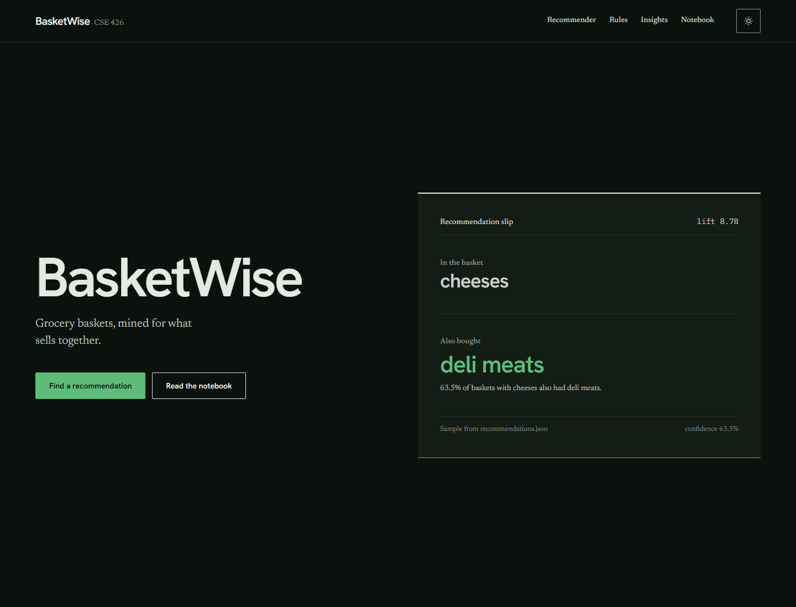
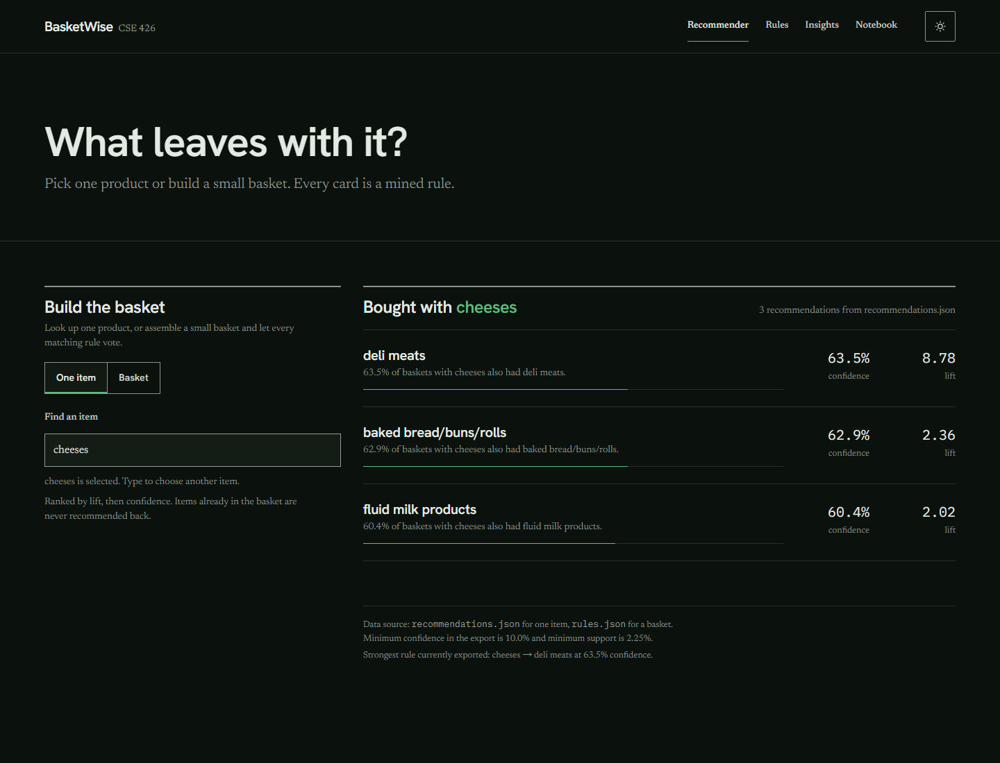
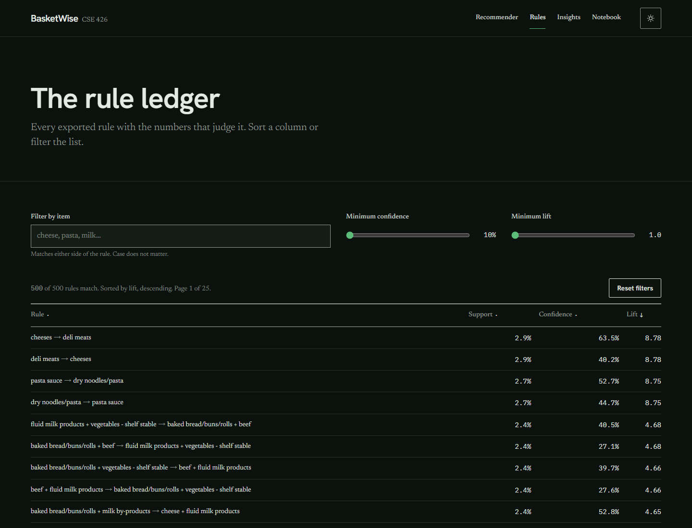
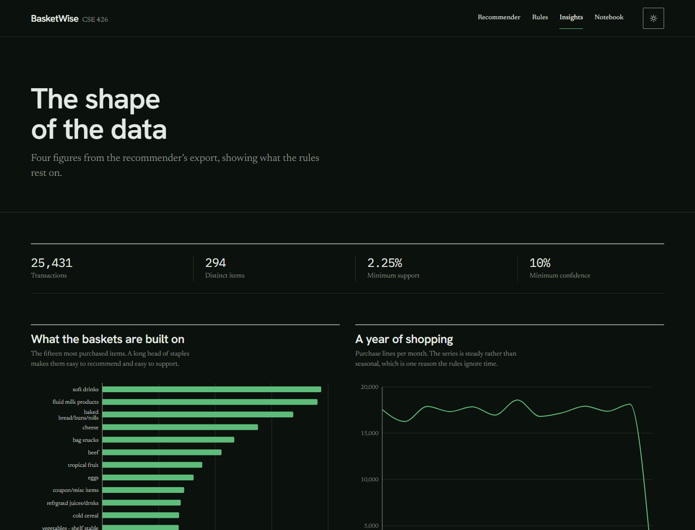
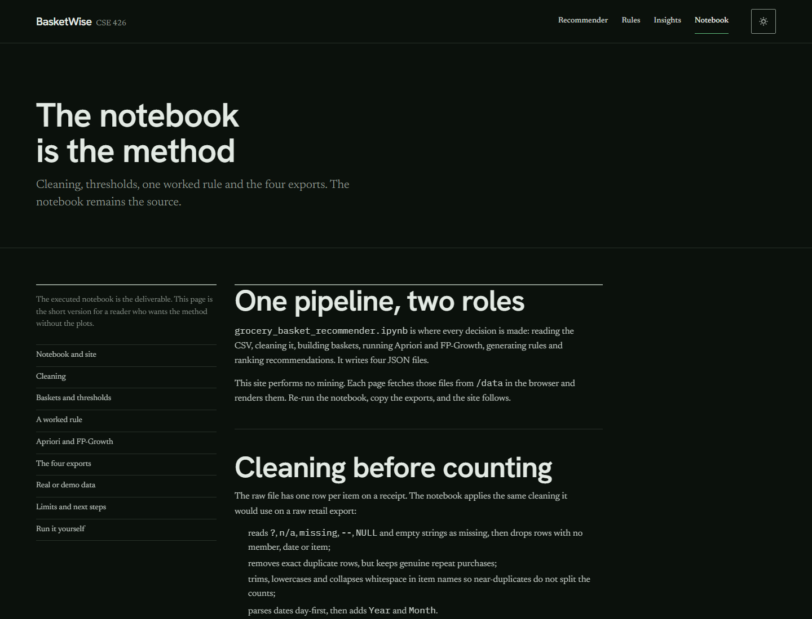

<div align="center">

# BasketWise

Market-basket analysis on real grocery receipts — frequent itemsets, association rules, and a rule-based recommender served as a fast static site.

[](https://basketwise-ten.vercel.app/)
&nbsp;
[](https://github.com/Srabon-bot/BasketWise/blob/main/notebooks/grocery_basket_recommender.ipynb)
&nbsp;
[](https://github.com/Srabon-bot/BasketWise)

</div>

---

## Overview

BasketWise takes the **Complete Journey** household grocery study, cleans 289,425 receipt lines, groups them into 25,431 shopping baskets, and mines what sells together with **Apriori** and **FP-Growth**. The strongest rules become a recommender that answers one practical question: *what leaves with this item?*

This is a solo **CSE 426 — Data Mining and Warehouse Lab** project. The executed Jupyter notebook is the source of truth; the website is a thin presentation layer that does no mining at all.

**Live site:** [https://basketwise-ten.vercel.app](https://basketwise-ten.vercel.app/)

> The best rule says it in one sentence: customers who bought `cheeses` also bought `deli meats` **63.5%** of the time — **8.78×** more often than chance.

---

## Screenshots

<div align="center">

### Home & Recommendation Slip



### Recommender — One Item



### Rule Ledger & Insights

<br />

| Rule Ledger | Insights |
|:---:|:---:|
|  |  |

### Methodology



</div>

---

## Features

- One executed notebook that runs the whole pipeline from raw receipts to JSON
- Cleaning for hidden missing values, exact duplicates, name variants, and day-first dates
- Basket construction from one household and one shopping date
- **Apriori** and **FP-Growth** on the same one-hot matrix, with an identical-itemset correctness check
- Automatic support tuning that keeps the rule set readable instead of flooding it
- Support, confidence, and lift calculated for every rule
- Item mode: pick a product and see the strongest single-item follow-ups
- Basket mode: add up to six items and match every rule whose whole antecedent fits
- A searchable, sortable, filterable ledger of all 500 exported rules
- Four charts covering top items, monthly volume, basket sizes, and algorithm runtime
- A JSON contract validator that blocks a broken export before it reaches the site
- Every number on screen read at runtime from JSON — nothing hard-coded
- Fully static Next.js export with light and dark themes
- Responsive layout, keyboard-accessible controls, and visible loading, error, and empty states
- A labelled synthetic fallback so the pipeline still runs without the real dataset

---

## Tech Stack

| Layer | Technology |
|---|---|
| Analysis |    |
| Mining |  Apriori, FP-Growth, `association_rules` |
| Visualisation |   |
| Notebook |  nbconvert, nbformat, pyreadr |
| Framework |  App Router, static export |
| UI library |  |
| Language |  |
| Styling |  |
| Charts |  |
| Data |  |
| Hosting |  |

---

## How It Works

```text
Raw receipts
    │  clean
    ▼
Shopping baskets
    │  one-hot encode
    ▼
Boolean basket matrix
    │  Apriori + FP-Growth
    ▼
Frequent itemsets
    │  association rules
    ▼
Ranked rules
    │  export + validate
    ▼
Four JSON files  ──►  Static Next.js site
```

1. **Clean.** Treat hidden tokens as missing, drop unusable rows, remove exact duplicates, normalise item text, and parse dates day-first.
2. **Build baskets.** One `Member_number` plus one `Date` becomes one transaction; repeated purchases of the same category collapse into a set.
3. **Encode.** mlxtend's `TransactionEncoder` turns the baskets into a boolean matrix — one row per basket, one column per item.
4. **Mine.** Apriori and FP-Growth find frequent itemsets at the same support threshold; `association_rules` splits them into antecedent → consequent rules.
5. **Rank and recommend.** Rules are filtered and ordered by lift, then confidence. Item mode uses exact single-item antecedents; basket mode requires the whole antecedent to be present.
6. **Export and present.** The notebook writes four JSON files, `validate_exports.py` checks their contracts, and the site renders them in the browser.

### The Three Metrics

| Metric | Formula | Question it answers |
|---|---|---|
| **Support** | `count(X ∪ Y) / N` | Is this combination common enough to trust? |
| **Confidence** | `count(X ∪ Y) / count(X)` | When X is in the basket, how often is Y there too? |
| **Lift** | `confidence / support(Y)` | Is this a real relationship, or just a popular item? |

A rule can have high confidence and almost no lift when the consequent is a staple that appears in most baskets. That is why the recommender ranks on **lift first**, never confidence alone.

---

## Results at a Glance

| Measure | Value |
| --- | --- |
| Raw receipt lines | 289,425 |
| Baskets after cleaning | 25,431 |
| Households | 500 |
| Product categories | 294 |
| Frequent itemsets | 763 |
| Rules generated | 2,451 |
| Positive rules (`lift > 1`) | 2,449 |
| Exported rules | 500 |
| Items with recommendations | 67 |
| Strongest rule by lift | `cheeses → deli meats` — 63.5% confidence, lift 8.78 |
| Apriori / FP-Growth runtime | 2.04 s / 24.57 s, identical itemsets |

### Strongest Rules

| Rule | Support | Confidence | Lift |
| --- | --- | --- | --- |
| `cheeses → deli meats` | 2.91% | 63.49% | 8.78 |
| `pasta sauce → dry noodles/pasta` | 2.69% | 52.73% | 8.75 |
| `baked bread/buns/rolls + beef → vegetables - shelf stable + fluid milk products` | 2.35% | 40.0% | 4.68 |

> **cheeses → deli meats** — deli meats are popular on their own, but they are still **8.78× more likely** when cheeses are in the basket. That is a real association, not just popularity.

Both algorithms returned the same **763** itemsets, which is the correctness check. Apriori was faster here because 294 category columns and roughly 25,000 baskets are not large enough for FP-Growth's tree overhead to pay off. The measured numbers are reported as they came out.

---

## Data & Exports

The mined "item" is a **product category** such as `cheeses` or `deli meats`, not an SKU. The CSV is rebuilt from the public **Complete Journey** study (84.51° / Dunnhumby) with a fixed sample of 500 households (seed 42); neither the raw files nor the derived CSV are committed to git.

After mining, the notebook writes four JSON files. These are the only data the site ever sees:

| File | Used by | Contents |
| --- | --- | --- |
| `rules.json` | rule ledger, basket mode | 500 positive rules with antecedents, consequents, support, confidence, and lift, sorted by lift |
| `recommendations.json` | item mode | each item mapped to its five best single-item follow-ups |
| `items.json` | recommender search | the 67 items that have recommendations, ordered by purchase count |
| `stats.json` | home, insights, methodology | counts, chart series, parameters, algorithm timing, and the data-source flag |

`scripts/validate_exports.py` checks all four files against their contracts — keys, types, ranges, ordering, four-decimal rounding, `lift > 1`, and that `items.json` and `recommendations.json` describe the same item set.

A **"Demo data"** banner appears on every page when `stats.json` reports `data_source: "synthetic"`. With the current Complete Journey run, it is absent.

---

## Pages

| Route | Page |
| --- | --- |
| `/` | Hero, headline counts, six-step pipeline, and a printed recommendation slip |
| `/recommend/` | Searchable item combobox plus a six-item basket mode |
| `/rules/` | Searchable, sortable ledger of all 500 rules with confidence and lift sliders |
| `/insights/` | Four Recharts figures: top items, monthly purchases, basket sizes, algorithm comparison |
| `/notebook/` | The method in short sections: cleaning, thresholds, a worked rule, exports, and limits |

There is no login, database, or server runtime. Every route is a static page that fetches its JSON from `/data` in the browser.

---

## Local Development

**Prerequisites:** Python 3.10+, Node.js 20.9+, and a free local environment for Jupyter. The real dataset is downloaded automatically by the fetch script.

### 1. Build the dataset and run the notebook

```bash
python -m venv .venv

# Windows PowerShell
.venv\Scripts\Activate.ps1

# macOS / Linux
source .venv/bin/activate

pip install -r requirements.txt
python scripts/fetch_completejourney.py
python scripts/build_notebook.py
python -m nbconvert --to notebook --execute --inplace notebooks/grocery_basket_recommender.ipynb
python scripts/validate_exports.py
```

The executed notebook is committed with its outputs and plots, so you can read it without running anything. Open it in Jupyter, VS Code, or Google Colab.

If `data/Groceries_dataset.csv` is missing, the notebook falls back to `scripts/make_synthetic_data.py`, writes a labelled demo dataset, and the site shows the **Demo data** banner. To return to the real run, rebuild the CSV, delete `data/DATA_SOURCE.txt`, and execute the notebook again.

### 2. Publish the exports to the site

```bash
# macOS / Linux
cp export/*.json web/public/data/

# Windows PowerShell
Copy-Item export\*.json web\public\data\ -Force
```

### 3. Run the website

```bash
cd web
npm install
npm run dev
```

Open [http://localhost:3000](http://localhost:3000).

The production build is a fully static export:

```bash
cd web
npm run lint
npm run build     # writes web/out/
npx serve out
```

The site fetches its four JSON files from `/data/*.json` at runtime. There is no server code, no database, and no required environment variable.

### Updating the data

1. Re-run the notebook as shown above.
2. Run `python scripts/validate_exports.py` and confirm it passes.
3. Copy the new exports into `web/public/data/`.
4. Reload the site. The counts, rule ledger, charts, and recommendations all follow the files automatically.

---

## Deployment

**Vercel (recommended).** Import the repository, set the project root to `web`, keep the detected Next.js framework and `npm run build`, and leave the output directory on its default. No environment variables are needed.

A step-by-step dashboard and CLI walkthrough, a verification checklist, and fixes for the usual 404s are in [`docs/DEPLOY_VERCEL.md`](docs/DEPLOY_VERCEL.md).

**GitHub Pages.** Push the repository, then publish `web/out`:

```bash
cd web
npm run build
npx gh-pages -d out
```

This works when the site is served from a domain root. A project site served from `username.github.io/BasketWise/` needs `basePath: "/BasketWise"` in `next.config.ts` **and** the data URLs prefixed with the same base path, because the browser requests `/data/*.json` by absolute path. The simplest free deployment is Vercel.

**Netlify.** Build command `npm run build`, publish directory `web/out`.

---

## Assumptions & Limitations

Every data, threshold, and export decision is recorded in [`ASSUMPTIONS.md`](ASSUMPTIONS.md), including the switch away from the original Kaggle file, the raised support threshold, and the curated rule export.

- **Sampled data:** 500 of the households in Complete Journey. Patterns may not generalise to every shopper.
- **Category granularity:** rules describe product groups such as `cheeses → deli meats`, not individual SKUs.
- **No quantities:** buying one unit or ten counts the same.
- **No time awareness:** a rule learned across 2017 may not hold this week.
- **Correlation, not causation:** "bought together" does not mean one product causes the other.
- **Rare items are excluded:** only 67 items clear the support threshold often enough to have recommendations.

AI assistance (OpenCode) was used to draft the notebook prose, build scripts, and website. Every number shown in the site is read from the exports, not written by hand; the notebook is the source of truth and its committed outputs are the evidence. The raw dataset is not redistributed, and no paid services, API keys, or secrets are involved.

---

## Repository Map

```text
BasketWise/
├── README.md
├── ASSUMPTIONS.md                  # every judgement call
├── PROJECT_GUIDE.md                # full step-by-step walkthrough
├── prd.md                          # original assignment spec
├── requirements.txt                # Python dependencies
├── data/                           # derived CSV + raw files (git-ignored)
├── scripts/
│   ├── fetch_completejourney.py    # raw data → CSV
│   ├── build_notebook.py           # generates the notebook source
│   ├── make_synthetic_data.py      # labelled demo fallback
│   └── validate_exports.py         # JSON contract tests
├── notebooks/                      # executed notebook with outputs
├── export/                         # rules, recommendations, items, stats
├── docs/
│   ├── DEPLOY_VERCEL.md
│   └── screenshots/
└── web/                            # Next.js static site
```

---

## Documentation

| Document | What it covers |
| --- | --- |
| [`PROJECT_GUIDE.md`](PROJECT_GUIDE.md) | The whole pipeline, every technique and function, the site walkthrough, and a 10-minute presentation script |
| [`ASSUMPTIONS.md`](ASSUMPTIONS.md) | Data, threshold, export, and website decisions |
| [`docs/DEPLOY_VERCEL.md`](docs/DEPLOY_VERCEL.md) | Vercel deployment, verification checklist, and common 404 fixes |
| [`prd.md`](prd.md) | The original project requirements |
| [`web/README.md`](web/README.md) | Site-specific notes for running, rebuilding, and deploying |

---

## Credits

Built by **Md. Shahriar Hossain Srabon** for **CSE 426 — Data Mining and Warehouse Lab**.

Data: **Complete Journey** by 84.51° / Dunnhumby, distributed through the public `completejourney` R package. Used for academic purposes; the raw files and derived CSV are not redistributed.

<div align="center">

<sub>Notebook in Python · Site in Next.js · Every number read from the exports</sub>

</div>
